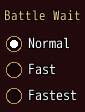
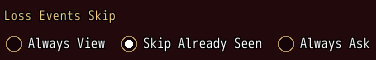
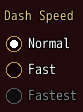

<!-- nav -->
[Mod Framework](../../README.md) › [UI components](README.md) › [Buttons and forms](README.md#buttons-and-forms)
<!-- /nav -->

# Radio group

`radio_group` holds radios of which the player picks one, as MudBlazor's radio group, such as one
of the game's settings with a few ways. Each `radio` stands with its label beside its round mark.
Bind the group to a state and the state keeps the value of the radio picked.

- Confirm or a click picks a radio, and the others let go of their pick.
- The arrows move from radio to radio and pick the one they reach, as a group of radios does. The
  focus coming in from a part outside the group picks nothing.
- A radio's `value:` stands for it in the bound state; without one its label does.

## Examples

### Bound to a state

<!-- example: radio_group-bind -->
```ruby
radio_group "Battle Wait", bind: :wait do
  radio "Normal", value: 100
  radio "Fast", value: 50
  radio "Fastest", value: 25
end
```


### In a row

<!-- example: radio_group-row -->
```ruby
radio_group "Loss Events Skip", bind: :loss_skip, row: true do
  radio "Always View", value: 0
  radio "Skip Already Seen", value: 1
  radio "Always Ask", value: 2
end
```


`row: true` lays the radios side by side; Left and Right then move and pick.

### A radio greyed out

<!-- example: radio_group-disabled -->
```ruby
radio_group "Dash Speed", bind: :dash_speed do
  radio "Normal", value: 0
  radio "Fast", value: 1
  radio "Fastest", value: 2, disabled: true
end
```


A radio with `disabled: true` is greyed out: the arrows pass over it and a click does nothing; its
tooltip still shows.

## Params, events and keys

Every part also takes [the params every part takes](README.md#params-every-part-takes).

<!-- generated: radio_group -->
Radios of which the player picks one, as MudBlazor's radio group, such as the game's Battle Wait; each is a radio.

Written `radio_group label, ...` with a `do ... end` block of markup.

| Param | Takes | Default | Live | About |
|---|---|---|---|---|
| `label:` | a text |  | yes | a caption above it, as MudBlazor draws an input's label |
| `bind:` | the name of a state |  |  | a state that holds the value of the radio picked, both ways; nil for none |
| `row:` | true, false | `false` |  | the radios stand in a row instead of under each other |
| `required:` | any value |  |  | true, or the error to show, such as "Name the formation": an empty value is an error, "Required" by default |
| `validate:` | a lambda of one item, or its method name |  |  | a lambda of its value answering the error to show, or nil while the value is fine, such as ->(name) { "Too short" if name.size < 3 }; a method name calls that method of the component |

| Event | Tells |
|---|---|
| `on_change` | the value of the radio the player picked |

**Keys:** the arrows move from radio to radio and pick the one they reach; confirm picks the radio the focus is on

**Pad:** the d-pad moves and picks as the arrows, A picks

**Mouse:** a click picks a radio
<!-- /generated -->

### Radio

<!-- generated: radio -->
One radio of a radio_group.

Written `radio label, ...`.
It goes inside `radio_group`.

| Param | Takes | Default | Live | About |
|---|---|---|---|---|
| `label:` | a text |  |  | its text beside its round mark |
| `value:` | any value |  |  | what stands for it in the radio group's bound value; its label by default |
<!-- /generated -->

<!-- nav -->
---

← [Color picker](color_picker.md) · [All components](README.md) · [Toggle group](toggle_group.md) →
<!-- /nav -->
