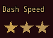
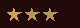

<!-- nav -->
[Mod Framework](../../README.md) › [UI components](README.md) › [Buttons and forms](README.md#buttons-and-forms)
<!-- /nav -->

# Rating

`rating` is a row of stars the player fills from the left, as MudBlazor's rating. Its first value,
`label:`, is a caption above it, as on every input. Bind it to a state and the state keeps how many
stars are filled, 0 for none.

- Right fills one more star and Left one less; Up and Down move on.
- A click fills the stars up to the one under the pointer, and a click on the last filled star
  empties them all. While the pointer rests on the stars, those up to it show filled.
- `read_only: true` only shows the stars: the keys pass over it and the pointer fills none. Give it
  `value:` instead of a state.

## Examples

### Bound to a state

<!-- example: rating-bind -->
```ruby
rating "Dash Speed", bind: :dash_speed, max_value: 3
```


### Only shown

<!-- example: rating-read-only -->
```ruby
rating value: $game_system.conf[:map_speed] + 1, max_value: 3, read_only: true, size: :small
```


`value:` fills the stars anew once it changes. `size:` takes `:small` (16 pixels), `:medium` (24,
the default) or `:large` (48), as an icon's, or pixels; `color:` colors the filled stars.

## Params, events and keys

Every part also takes [the params every part takes](README.md#params-every-part-takes).

<!-- generated: rating -->
Stars the player fills from the left, as MudBlazor's rating, such as how fast the player dashes; with read_only: true it only shows them.

Written `rating label, ...`.

| Param | Takes | Default | Live | About |
|---|---|---|---|---|
| `label:` | a text |  | yes | a caption above it, as MudBlazor draws an input's label |
| `bind:` | the name of a state |  |  | a state that holds how many stars are filled, both ways |
| `value:` | a whole number |  |  | how many stars are filled, without bind:, such as on one that only shows them; it fills them anew once it changes, and the player's change stays between |
| `max_value:` | a whole number | `5` |  | how many stars it has |
| `read_only:` | true, false | `false` |  | it only shows its stars: the keys pass over it and the pointer fills none |
| `size:` | px, `:small`, `:medium`, `:large` | `:medium` |  | the side of a star: :small (16 px), :medium (24 px) or :large (48 px), as an icon's, or pixels |
| `color:` | a color name such as :primary or :rainbow, "#RRGGBB", [r, g, b] or a game text color such as 2 |  |  | the color of the filled stars; the theme's primary color by default |
| `required:` | any value |  |  | true, or the error to show, such as "Name the formation": an empty value is an error, "Required" by default |
| `validate:` | a lambda of one item, or its method name |  |  | a lambda of its value answering the error to show, or nil while the value is fine, such as ->(name) { "Too short" if name.size < 3 }; a method name calls that method of the component |

| Event | Tells |
|---|---|
| `on_change` | how many stars are filled, as the player filled them, 0 for none |

**Keys:** Right fills one more star and Left one less; Up and Down move on

**Pad:** the d-pad's Left and Right fill one less or one more

**Mouse:** a click fills the stars up to the one under the pointer, and a click on the last filled star empties them; the stars up to the one under the pointer show filled while it rests there
<!-- /generated -->

<!-- nav -->
---

← [Slider](slider.md) · [All components](README.md) · [Color picker](color_picker.md) →
<!-- /nav -->
