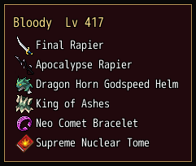

<!-- nav -->
[Mod Framework](../../README.md) › [UI components](README.md) › [Services](README.md#services)
<!-- /nav -->

# Replace scene

`UI.replace_scene(SceneClass, Component, if:, params:)` opens a component of your own in the place
of one of the game's scenes. Each time the game calls the scene while `if:` answers true, it runs a
stand-in instead that opens the component over the game's blurred background, and closing the
component returns where the scene would have returned. The component's render describes a
`window`. While `if:` answers false, the game's own scene runs as before.

## Examples

### The menu's Equip, on an options row

<!-- example: replace_scene-equip -->
```ruby
# Once, as the mod loads:
module Gear_Screen
  UI = Mod_Framework::UI

  # The equip screen of the character the menu picked.
  class GearWindow < UI::Component
    param :actor

    def render
      window UI::Game.actor_title(actor), id: :gear_screen do
        list UI::Equip.slot_rows(actor), id: :gear_screen_slots
      end
    end
  end

  Mod_Framework::Options.add(:gear_screen_on, "[Gear Screen] Equip Command", "Which screen the menu's Equip opens.",
                             { 1 => "Gear Screen", 0 => "Game's Screen" }, 1)
  UI.replace_scene Scene_Equip, GearWindow, if: -> { Mod_Framework::Options.value(:gear_screen_on) != 0 },
                                            params: ->(scene) { { actor: scene.actor } }
end

# In render: nothing; the menu's Equip opens the window in place of the game's equip screen.
```


`params:` gets the stand-in scene, whose `actor` is the character the menu picked, and answers the
component's params. Keep `if:` on a row of Options > Mods, so the player can have the game's screen
back; it is asked each time the game calls the scene, so a change of the row counts at the next
call. The Equipment Window replaces the equip screen this way.

## Order and failures

- One component replaces a scene. The last mod loaded that replaces it wins, and the log names
  both.
- An `if:` that raises is logged once, and the game's own scene runs.
- A component that fails to open is logged, and the stand-in returns at once, as a closed window
  does.

<!-- nav -->
---

← [Replace window](replace_window.md) · [All components](README.md) · [Patch](patch.md) →
<!-- /nav -->
