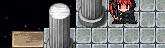

<!-- nav -->
[Mod Framework](../../README.md) › [UI components](README.md) › [Services](README.md#services)
<!-- /nav -->

# Replace window

`UI.replace_window(WindowClass, Component, if:, params:)` draws a component of your own in the
place of one of the game's windows. The game still makes, opens and closes its window, so the
game's code that calls it keeps working, but the window draws nothing while your component shows.
The component's render describes a `hud` (shown as `UI.show` shows one) or a `window` (opened as
`UI.open` opens one). It shows as each window of the class is made and goes as the window is
disposed; while `if:` answers false, the game's own window draws as before.

## Examples

### The map's name as a banner

<!-- example: replace_window-map-name -->
```ruby
# Once, as the mod loads:
module Map_Display
  UI = Mod_Framework::UI

  # The map's name, shown while the game's map name window would show.
  class Banner < UI::Component
    # The game's map name window, which still decides when the name shows.
    param :game_window

    def render
      hud anchor: :top_left, order: 50, id: :map_display, place_name: "Map name", enter: :slide,
          hide_while: -> { !game_window.shown? } do
        stack row: true, spacing: 2 do
          text UI::Game.map_name, typo: :subtitle1
          divider vertical: true, color: :primary, thickness: 3
        end
      end
    end
  end

  UI.replace_window Window_MapName, Banner
end

# In render: nothing; the banner shows each time the game makes its map name window.
```


A component that declares `param :game_window` gets a handle of the game's window: `shown?` (the
game would show it: visible, open and its contents not faded out), `open?` and `refreshes` (how
often the game drew its contents anew; a render that reads it renders again after each).
`hide_while:` hides the banner while the game would not show its window, keeping the HUD and its
place, and `enter: :slide` slides it in from the left edge and out again, as the game's own name
window fades. `order: 50` puts it after the HUD parts of order 0 and before the notices (100) in
the top left zone.

### Only while an option is on

```ruby
UI.replace_window Window_Gold, GoldBox, if: -> { Mod_Framework::Options.value(:my_mod_gold) != 0 },
                                        params: ->(window) { { wide: window.width > 200 } }
```

`params:` gets the game's window and answers the component's other params. The last mod loaded
that replaces a class wins, and the log names both.

<!-- nav -->
---

← [Needed mods](needed_mods.md) · [All components](README.md) · [Replace scene](replace_scene.md) →
<!-- /nav -->
