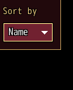
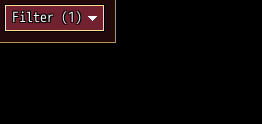
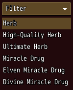

<!-- nav -->
[Mod Framework](../../README.md) › [UI components](README.md) › [Buttons and forms](README.md#buttons-and-forms)
<!-- /nav -->

# Select

`select` is a button that opens a menu of values below it. Without `multi:` a pick turns one value
on, closes the menu and shows on the button; with `multi: true` any number of them turn on and off,
such as the filters of a list, and the button names how many are on. Each value is a `select_item`.
Bind it to a state: without `multi:` the state holds the one value picked, as MudSelect does, and
with `multi: true` an Array of the values that are on. `label:` (its first value) is a caption above
it, as on every input; `placeholder:` is the button's text while no value is on. The open menu
lies above every window and dialog, also one opened after it, moves with its own window as the
player Alt-drags it and closes with it.

## Examples

### One value

<!-- example: select-one -->
```ruby
select "Sort by", bind: :sort do
  select_item "Name", value: :name
  select_item "Price", value: :price
end
```


### Filters

<!-- example: select-filters -->
```ruby
select placeholder: "Filter", bind: :filters, multi: true, columns: 2, clear_text: "Clear" do
  select_item "Favorites", value: :favorite, icon: 191
  select_item "Usable", value: :usable
  select_item "Swords", value: :sword
  select_item "Spears", value: :spear
end
```


### Opened by the game's button, lined up with its list

<!-- example: select-steer -->
```ruby
select placeholder: "Filter", bind: :filters, multi: true, clear_text: "Clear", steer: :herbs, button: :z, id: :filter do
  select_item "Usable", value: :usable
  select_item "Rare", value: :rare
end
list herbs, id: :herbs, text: :name, bind: :herb, on_button: { z: -> { part(:filter).open_menu } }, button_help: { z: "Filter" }
```


With `steer:` the menu lines up with the list's left edge and width, and its Clear entry tells how
many rows the list shows while a value is on. `part(:filter).open_menu` opens it from the list, here
by the game's Z (D on the keyboard) as the game's equip list does, and `button: :z` closes it again.

## Params, events and keys

Every part also takes [the params every part takes](README.md#params-every-part-takes).

<!-- generated: select -->
A button that opens a menu of values below it: one is picked, or any number turned on with multi: true, such as the filters of a list. Each value is a select_item.

Written `select label, ...` with a `do ... end` block of markup.

| Param | Takes | Default | Live | About |
|---|---|---|---|---|
| `label:` | a text |  | yes | a caption above it, as MudBlazor draws an input's label |
| `placeholder:` | a text |  | yes | the button's text while no value is on, such as "Filter"; with multi: true it names how many are on, "Filter (2)" |
| `bind:` | the name of a state |  |  | a state that holds the value picked, both ways; with multi: true the values that are on, an Array |
| `multi:` | true, false | `false` |  | any number of values may be on; false keeps one, which a pick turns on and closes the menu, and the button shows it |
| `columns:` | a whole number, `:auto` | `:auto` |  | the menu's columns; :auto as many as keep it to most_rows: lines |
| `most_rows:` | a whole number | `8` |  | the most lines of the menu with columns: :auto |
| `clear_text:` | a text |  |  | an entry after the others that turns every value off, such as "Clear" |
| `steer:` | a Symbol or a text |  |  | the id of a list in its window whose left edge and width its menu takes, and whose rows its clear_text: entry counts while a value is on |
| `button:` | `:a`, `:x`, `:y`, `:z` |  |  | one of the game's buttons that closes its open menu, such as the one a list's on_button: opens it with |
| `required:` | any value |  |  | true, or the error to show, such as "Name the formation": an empty value is an error, "Required" by default |
| `validate:` | a lambda of one item, or its method name |  |  | a lambda of its value answering the error to show, or nil while the value is fine, such as ->(name) { "Too short" if name.size < 3 }; a method name calls that method of the component |

| Event | Tells |
|---|---|
| `on_change` | the value picked, nil once cleared; with multi: true the values that are on now |
| `on_open` | nothing; its menu opened |
| `on_close` | nothing; its menu closed |

| Call on `part(:id)` | Does |
|---|---|
| `open_menu` | opens its menu with the keys in it, such as from a list's on_button: |
| `close_menu` | closes its menu |

**Keys:** confirm opens the menu; in it the arrows move, confirm turns a value on or off, cancel, its button: or confirm on the button closes it

**Pad:** as the keys

**Mouse:** a click opens and closes the menu; a click on a value turns it on or off
<!-- /generated -->

### Select item

<!-- generated: select_item -->
One value of a select.

Written `select_item text, ...`.
It goes inside `select`.

| Param | Takes | Default | Live | About |
|---|---|---|---|---|
| `text:` | a text |  |  | what it says |
| `icon:` | an IconSet index, a name UI.icon gave one, or { file: "Graphics/Pictures/x" } |  |  | an icon before its text |
| `value:` | any value |  |  | what stands for it in the select's bound values; its text by default |
<!-- /generated -->

<!-- nav -->
---

← [Form](form.md) · [All components](README.md) · [Hotkey field](hotkey_field.md) →
<!-- /nav -->
