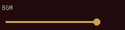
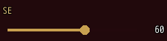
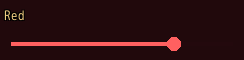

<!-- nav -->
[Mod Framework](../../README.md) › [UI components](README.md) › [Buttons and forms](README.md#buttons-and-forms)
<!-- /nav -->

# Slider

`slider` is a whole number the player slides between its bounds, as MudBlazor's slider, such as a
volume of the game's Volume Settings. Its first value, `label:`, is a caption above it, as on every
input. Bind it to a state and the state keeps its number.

- Left and Right step it by `step:`; at a bound a step does nothing. Up and Down move on, so a
  column of sliders reads like the game's option rows.
- A click on the track sets the number at the pointer, and a held press drags the knob.
- The number keeps to steps from `min:`: a number the mod sets in between goes to the nearest step,
  and the bound state and `on_change` hear that step.

## Examples

### Bound to a state

<!-- example: slider-bind -->
```ruby
slider "BGM", bind: :bgm, step: 5
```


### With its number

<!-- example: slider-value -->
```ruby
slider "SE", bind: :se, step: 5, show_value: true
```


`show_value: true` shows the number at the track's right end.

### Below zero

<!-- example: slider-tone -->
```ruby
slider "Red", bind: :tone_red, min: -255, max: 255, color: :error
```


`min:` may lie below 0, as a tone of the window color does; `color:` colors the track up to the knob
and the knob.

## Params, events and keys

Every part also takes [the params every part takes](README.md#params-every-part-takes).

<!-- generated: slider -->
A whole number the player slides between its bounds, as MudBlazor's slider, such as the volume of the music.

Written `slider label, ...`.

| Param | Takes | Default | Live | About |
|---|---|---|---|---|
| `label:` | a text |  | yes | a caption above it, as MudBlazor draws an input's label |
| `bind:` | the name of a state |  |  | a state that holds its number, both ways |
| `min:` | a whole number | `0` |  | the least number |
| `max:` | a whole number | `100` |  | the largest number |
| `step:` | a whole number | `1` |  | what a step adds or takes away; the number keeps to steps from min: |
| `show_value:` | true, false | `false` |  | the number shows at the right end of the track |
| `color:` | a color name such as :primary or :rainbow, "#RRGGBB", [r, g, b] or a game text color such as 2 |  |  | the color of the track up to the knob and of the knob; the theme's primary color by default |
| `required:` | any value |  |  | true, or the error to show, such as "Name the formation": an empty value is an error, "Required" by default |
| `validate:` | a lambda of one item, or its method name |  |  | a lambda of its value answering the error to show, or nil while the value is fine, such as ->(name) { "Too short" if name.size < 3 }; a method name calls that method of the component |

| Event | Tells |
|---|---|
| `on_change` | its number, as the player slid it |

**Keys:** Left and Right step it, at a bound nothing; Up and Down move on

**Pad:** the d-pad's Left and Right step it

**Mouse:** a click on the track sets the number there; a held press drags the knob
<!-- /generated -->

<!-- nav -->
---

← [Switch](switch.md) · [All components](README.md) · [Rating](rating.md) →
<!-- /nav -->
