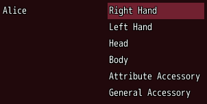
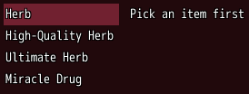
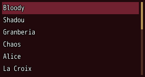
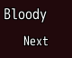

<!-- nav -->
[Mod Framework](../../README.md) › [UI components](README.md) › [Layout](README.md#layout)
<!-- /nav -->

# Slides

`slides` lays pages side by side and slides between them, such as a character page that gives way
to the details of the item picked. Each page is a `slide`. Right or Left at the edge of the page the
focus is on slides a page that way, and cancel slides back before it closes the window. On the
part the window opened on, cancel closes the window at once, even while a later page shows.

## Examples

### Two pages of three

<!-- example: slides-two -->
```ruby
slides bind: :page, shown: 2 do
  slide do
    text "Alice"
  end
  slide do
    list slots, bind_index: :slot
  end
  slide do
    text slot_details
  end
end
```


### Buttons that slide

<!-- example: slides-buttons -->
```ruby
slides do
  slide do
    text "Herb"
    button "Details", on_click: :forward
  end
  slide do
    button "Back", on_click: :back
    text "Medicinal herb that recovers 50 HP."
  end
end
```


The keys skip a button whose `on_click:` is `:forward` or `:back`, since they slide anyway; the
mouse uses it. From your own code, such as after a save, the component's `forward` and `back` slide
the first slides its render made.

### A page that waits for a pick

<!-- example: slides-can-enter -->
```ruby
slides shown: 2 do
  slide do
    list items, text: :name, bind: :item
  end
  slide do
    text "Pick an item first"
  end
  slide can_enter: -> { item_ready? } do
    text item_details
  end
end
```


### A page a pick opens

<!-- example: slides-enter-page -->
```ruby
slides bind: :page, enter: true do
  slide do
    list $game_party.members, text: :name, on_submit: ->(member) { self.member = member; self.page = 1 }
  end
  slide do
    text member ? member.name : "", typo: :h6
    button "Lead", autofocus: true, on_click: -> { lead(member) }
    button "Back", on_click: :back
  end
end
```


With `enter: true` a page the bound state slides to takes the focus, here Lead, its part with
`autofocus:`, else its first key stop; so confirm on a row opens its page with the focus on its
first button. Cancel slides back onto the list, the cursor on the
same row.

### Easing in for another character

<!-- example: slides-enter -->
```ruby
slides id: :pages do
  slide do
    text member.name, typo: :h6
  end
end
button "Next", on_click: -> { self.member = next_member; part(:pages).enter_from(1) }
```


`part(:pages)` hands out the slides of that id, and `enter_from` eases its pages in from the side the
step points to, the right for 1 and the left for -1, as the Equipment Window does when Q or W
switch the character.

## Params, events and keys

Every part also takes [the params every part takes](README.md#params-every-part-takes).

<!-- generated: slides -->
Pages side by side that slide, such as a character page that gives way to the details of the item picked. Each page is a slide; shown: tells how many show at once.

Written `slides ...` with a `do ... end` block of markup.

| Param | Takes | Default | Live | About |
|---|---|---|---|---|
| `bind:` | the name of a state |  |  | a state that holds the first page shown, both ways: 0 for the first |
| `shown:` | `1`, `2`, `3` | `1` |  | how many pages show side by side |
| `spacing:` | `0`, `1`, `2`, `3`, `4`, `5`, `6` | `3` |  | room between two pages, 4 px a unit |
| `enter:` | true, false | `false` |  | a page the bound state slides to takes the focus: its part with autofocus:, else its first key stop, such as the buttons of a page a pick opened |

| Event | Tells |
|---|---|
| `on_change` | the first page shown, as a slide starts: 0 for the first |
| `on_refuse` | the page a slide would have brought into view, refused by its can_enter: false |

| Call on `part(:id)` | Does |
|---|---|
| `enter_from(step)` | the pages ease in from the side a step points to, the right for 1 and the left for -1, such as after the window switched to another character |

**Keys:** Right or Left at the edge of the page the focus is on slides a page that way; cancel slides a page back before it reaches the window, except on the part the window opened on; a slide brings a page into view as the focus enters it

**Pad:** the d-pad as the arrows; B as cancel

**Mouse:** a button inside with on_click: :forward or :back slides a page on or back, which the keys skip
<!-- /generated -->

### Slide

<!-- generated: slide -->
One page of slides: a column of parts. Its slides decides when it shows.

Written `slide ...` with a `do ... end` block of markup.
It goes inside `slides`.

| Param | Takes | Default | Live | About |
|---|---|---|---|---|
| `can_enter:` | true, false | `true` | yes | false refuses a slide that would bring it into view, with the buzzer and on_refuse of its slides |
| `spacing:` | `0`, `1`, `2`, `3`, `4`, `5`, `6` | `2` |  | room between its parts, 4 px a unit |
<!-- /generated -->

<!-- nav -->
---

← [Divider](divider.md) · [All components](README.md) · [Drawer](drawer.md) →
<!-- /nav -->
