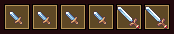
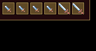
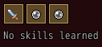
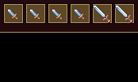

<!-- nav -->
[Mod Framework](../../README.md) › [UI components](README.md) › [Display](README.md#display)
<!-- /nav -->

# Slot row

`slot_row` is a row of icon slots, such as a party member's skills or the gems in an item's
sockets. Each slot shows its icon, and resting the pointer on it shows its tooltip; an empty slot
shows the empty mark. With `on_pick` the player picks a slot by the keys or a click. The row
wraps when it is full.

## Examples

### A party member's skills

<!-- example: slot_row-skills -->
```ruby
slot_row actor.skills.first(6).map { |skill| { icon: skill.icon_index, tooltip: skill.name } }
```


### Picking a slot

<!-- example: slot_row-pick -->
```ruby
slot_row actor.skills.first(6).map { |skill| { icon: skill.icon_index, tooltip: skill.name } },
         note: "Click to put it first", on_pick: ->(place) { toast actor.skills[place].name }
```


`note:` takes markup, which ends the tooltip of every slot that is not empty, such as
`note: -> { text "Click to put it first", color: :success }`; a text, as above, is one line of text.

### Empty slots

<!-- example: slot_row-empty -->
```ruby
slot_row [actor.skills.first && actor.skills.first.icon_index, nil, nil], empty_icon: UI::Game.empty_socket_icon, empty_tooltip: "No skill"
slot_row [], empty: "No skills learned"
```


An empty slot is `nil`; it shows `empty_icon:`, or an empty well without it. A row without slots
shows `empty:` in its place.

### Tooltips of markup

<!-- example: slot_row-markup -->
```ruby
slot_row actor.skills.first(6).map { |skill| { icon: skill.icon_index, tooltip: -> { text skill.name, typo: :subtitle2; text "#{skill.mp_cost} MP", color: :system } } }
```


A slot's `tooltip:` takes markup as a lambda, as a [tooltip](tooltip.md) does; it reads the
component's state as it opens, and the slots are not made anew while only what it shows changes.

### Pulsing the slots a change touched

<!-- example: slot_row-pulse -->
```ruby
slot_row actor.skills.first(6).map { |skill| { icon: skill.icon_index, tooltip: skill.name } },
         id: :skills, on_pick: ->(place) { part(:skills).pulse([place]) }
```


`part(:skills).pulse` pulses the slots once; asked as the slots change, they pulse as they show
anew.

## Params, events and keys

Every part also takes [the params every part takes](README.md#params-every-part-takes).

<!-- generated: slot_row -->
A row of icon slots to pick, such as the gems in an item's sockets or a party member's skills: each slot its icon with its tooltip, or the empty mark.

Written `slot_row slots, ...`.

| Param | Takes | Default | Live | About |
|---|---|---|---|---|
| `slots:` | an Array | `[]` |  | a slot each: nil for an empty one, an icon, or { icon:, tooltip:, disabled: }, tooltip: a text or markup as a lambda, such as -> { text "Ruby" } |
| `empty_icon:` | an IconSet index, a name UI.icon gave one, or { file: "Graphics/Pictures/x" } |  |  | the empty mark: the icon of an empty slot; an empty well without it |
| `empty_tooltip:` | a text |  |  | the tooltip of an empty slot |
| `empty:` | a text |  |  | what shows, dim, in place of the row without slots |
| `note:` | markup as a lambda, or a text for one line |  |  | parts at the end of the tooltip of each slot that is not empty, such as "Click to change" |

| Event | Tells |
|---|---|
| `on_pick` | the slot picked, from 0 |

| Call on `part(:id)` | Does |
|---|---|
| `pulse(slots)` | pulses those slots once, from 0, such as those a change just touched; asked as they change, they pulse as they show anew |

**Keys:** with on_pick: as it is made, each slot takes the keys and confirm picks it; without, the keys pass over them

**Pad:** as the keys

**Mouse:** a click picks a slot; resting on one shows its tooltip

**Places:** `note`, the parts at the end of each slot's tooltip
<!-- /generated -->

<!-- nav -->
---

← [Header](header.md) · [All components](README.md) · [Stat grid](stat_grid.md) →
<!-- /nav -->
