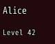
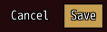
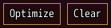
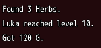

<!-- nav -->
[Mod Framework](../../README.md) › [UI components](README.md) › [Layout](README.md#layout)
<!-- /nav -->

# Stack

`stack` lays its parts out in a column, or in a row with `row: true`. The gaps come from the theme's
spacing, so you write no pixel offsets.

## Examples

### A column

<!-- example: stack-column -->
```ruby
stack do
  text "Alice"
  text "Level 42", typo: :caption
end
```


### A row of buttons at the end

<!-- example: stack-row -->
```ruby
stack row: true, justify: :end do
  button "Cancel", on_click: :close
  button "Save", variant: :filled, on_click: -> { save }
end
```


### Sharing the room

<!-- example: stack-grow -->
```ruby
stack row: true do
  button "Optimize", variant: :outlined, grow: 1, on_click: -> { optimize }
  button "Clear", variant: :outlined, grow: 1, on_click: -> { clear }
end
```


### The newest at the bottom

With `tail: true` a column keeps its newest parts: it fills from its bottom and leaves out from the
top what its height does not hold, a wrapped text its first lines first. It suits status lines and
logs.

<!-- example: stack-tail -->
```ruby
stack tail: true, height: 72, spacing: 0 do
  text "Alice joined the party."
  text "Found 3 Herbs."
  text "Luka reached level 10."
  text "Got 120 G."
end
```


## Params, events and keys

Every part also takes [the params every part takes](README.md#params-every-part-takes).

<!-- generated: stack -->
Parts in a column, or in a row with row: true.

Written `stack ...` with a `do ... end` block of markup.

| Param | Takes | Default | Live | About |
|---|---|---|---|---|
| `row:` | true, false | `false` |  | true lays its parts out in a row |
| `spacing:` | `0`, `0.5`, `1`, `1.5`, `2`, `2.5`, `3`, `3.5`, `4`, `4.5`, `5`, `5.5`, `6` | `2` |  | room between its parts, 4 px a unit, also half a unit such as 2.5 |
| `justify:` | `:start`, `:center`, `:end`, `:space_between` | `:start` |  | where its parts sit along it when room is left |
| `wrap:` | true, false | `false` |  | a row goes on in a new line when full |
| `tail:` | true, false | `false` |  | a column keeps its newest parts: it lays them out from its bottom and leaves out from the top what its height does not hold, a wrapped text its first lines first, such as status lines or a log |
| `on_button:` | { z: -> { ... } }: a lambda or a method name, or nil, for each of the game's buttons :a, :x, :y and :z it takes |  |  | what the game's buttons :a, :x, :y and :z (Shift, A, S and D on the keyboard) do while the focus is on it or inside it, such as { z: -> { open_filter } }; only where a screen mirrors the game's own |
| `button_help:` | { z: "Filter" }: what each button of on_button: does, for the key help |  |  | what each button of on_button: does, which the key help names, such as { z: "Filter" }; nil leaves a button out, such as on a row it does nothing on |

| Event | Tells |
|---|---|
| `on_page` | Q or W, or a gamepad's shoulder without tabs in view, reached it from the focus upward: -1 for the page before, 1 for the next |
| `on_submit` | a list inside it without on_submit: picked an item, nearest first: the item |
<!-- /generated -->

<!-- nav -->
---

← [Wheel](wheel.md) · [All components](README.md) · [Container](container.md) →
<!-- /nav -->
