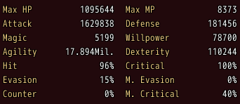
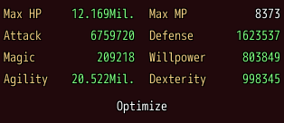
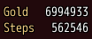

<!-- nav -->
[Mod Framework](../../README.md) › [UI components](README.md) › [Display](README.md#display)
<!-- /nav -->

# Stat grid

`stat_grid` shows name and value rows in columns, such as a party member's stats. Given the rows
before a change as `before:`, it colors each value that rose in the game's color for better and
each that fell in its color for worse, as the game's equip screen does. A row is
`{ name:, value: }`; `UI::Game.stat_rows(actor)` tells a party member's stats as such rows.

## Examples

### A party member's stats

<!-- example: stat_grid-member -->
```ruby
stat_grid UI::Game.stat_rows(actor), columns: 2, size: :small
```


### Before and after new gear

<!-- example: stat_grid-before -->
```ruby
stat_grid UI::Game.stat_rows(actor, rates: []), before: before, columns: 2
button "Optimize", on_click: -> { self.before = UI::Game.stat_rows(actor, rates: []); actor.optimize_equipments }
```


`before` is a state here, which holds the rows until the next change. A row is judged against the
row of the same `key:`, else of the same name; a value that is no number, such as `"+20%"`,
compares by its `number:`.

### Rows of your own

<!-- example: stat_grid-own -->
```ruby
stat_grid [{ name: "Gold", value: $game_party.gold }, { name: "Steps", value: $game_party.steps }], dense: true
```


## Params, events and keys

Every part also takes [the params every part takes](README.md#params-every-part-takes).

<!-- generated: stat_grid -->
Name and value rows in columns, such as a party member's stats; given the rows before a change, it colors the values that rose or fell in the game's colors for better and worse.

Written `stat_grid rows, ...`.

| Param | Takes | Default | Live | About |
|---|---|---|---|---|
| `rows:` | an Array | `[]` |  | a row each: { name:, value: }, with key: when two rows share a name, and number: for a value that is no number, such as 20 for "+20%" |
| `before:` | an Array |  |  | the rows before a change, such as before new gear: a value higher than the row of the same key or name there shows in the game's color for better, a lower one in its color for worse |
| `columns:` | a whole number | `1` |  | how many columns the rows fill |
| `size:` | `:small`, `:medium`, `:large` | `:medium` |  | the size of its font |
| `dense:` | true, false | `false` |  | lower rows and less room between the columns |

**Keys:** none

**Mouse:** none
<!-- /generated -->

<!-- nav -->
---

← [Slot row](slot_row.md) · [All components](README.md) · [Lines](lines.md) →
<!-- /nav -->
