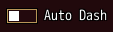
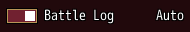

<!-- nav -->
[Mod Framework](../../README.md) › [UI components](README.md) › [Buttons and forms](README.md#buttons-and-forms)
<!-- /nav -->

# Switch

`switch` is a switch the player turns on and off, such as a choice between two ways. Its label
stands beside it. Left and Right turn it as well as confirm and a click, as the game's option rows
step a value. Bind it to a state and the state keeps whether it is on.

## Examples

### Bound to a state

<!-- example: switch-bind -->
```ruby
switch "Auto Dash", bind: :dash
```


### Two named ways

<!-- example: switch-values -->
```ruby
switch "Battle Log", bind: :auto_log, values: ["Manual", "Auto"]
```


`values:` names off and on, and the one that holds shows at the switch's right end.

## Params, events and keys

Every part also takes [the params every part takes](README.md#params-every-part-takes).

<!-- generated: switch -->
A switch the player turns on and off, with its label beside it, such as a choice between two ways; values: names the two at its right end.

Written `switch label, ...`.

| Param | Takes | Default | Live | About |
|---|---|---|---|---|
| `label:` | a text |  | yes | its text beside its mark, as MudBlazor draws a checkbox's label |
| `bind:` | the name of a state |  |  | a state that holds whether it is on, both ways |
| `values:` | an Array |  |  | the texts of off and on, such as ["Walk", "Dash"], the one that holds shown at its right end |
| `required:` | any value |  |  | true, or the error to show, such as "Name the formation": an empty value is an error, "Required" by default |
| `validate:` | a lambda of one item, or its method name |  |  | a lambda of its value answering the error to show, or nil while the value is fine, such as ->(name) { "Too short" if name.size < 3 }; a method name calls that method of the component |

| Event | Tells |
|---|---|
| `on_change` | whether it is on now, as the player turned it |

**Keys:** Left, Right and confirm turn it, as the game's option rows step a value

**Pad:** the d-pad's Left and Right and A turn it

**Mouse:** a click turns it
<!-- /generated -->

<!-- nav -->
---

← [Checkbox](checkbox.md) · [All components](README.md) · [Slider](slider.md) →
<!-- /nav -->
