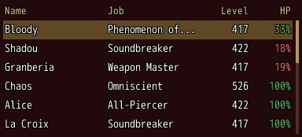
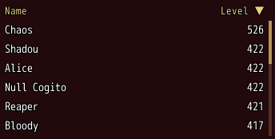
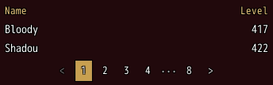
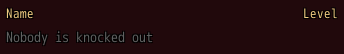
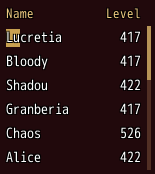

<!-- nav -->
[Mod Framework](../../README.md) › [UI components](README.md) › [Lists](README.md#lists)
<!-- /nav -->

# Table

`table` shows items in rows under the titles of their columns, such as the party members with
their job and level. Each `column` names one column: its title, what an item shows there, and
whether the player may sort by it. A table stays one part with its rows as data, however many
rows it has, and keeps all a list has: the cursor, `bind:`, `on_submit` and the mouse wheel.

## Examples

### Columns

<!-- example: table-columns -->
```ruby
table $game_party.members, bind: :picked do
  column "Name", value: :name
  column "Job", value: ->(member) { member.class.name }
  column "Level", value: :base_level, align: :end, width: 48
  column "HP", value: ->(member) { { text: "#{member.hp * 100 / member.mhp}%", color: member.hp < member.mhp / 4 ? :error : :success } },
               align: :end, width: 48
end
```


`value:` takes the item's method name or a lambda of the item. It answers a text or a number, or
`{ text:, color: }` for a cell in a color of its own. A column without `width:` shares the room
the others leave.

### Sorted by the player

<!-- example: table-sort -->
```ruby
table $game_party.members, sort: [:level, :desc], on_sort: ->(column, direction) { say("Sorted by #{column}") } do
  column "Name", value: :name, sortable: true
  column "Level", value: :base_level, sortable: true, align: :end, width: 64, id: :level
end
```


The title of a `sortable:` column takes the keys: Ctrl and Up from the rows reach the titles, Left
and Right walk them, and confirm or a click sorts up, down, then unsorted again. Numbers sort by
size, texts in any case. `sort:` names the column the rows start sorted by, by its `id:` or title.

### Pages and a filter

<!-- example: table-pages -->
```ruby
table $game_party.members, rows_per_page: 2, dense: true, filter: ->(member) { member.base_level >= 100 } do
  column "Name", value: :name
  column "Level", value: :base_level, align: :end, width: 48
end
```


With `rows_per_page:` a pagination under the table turns its pages, and so do Page Up and Page Down
while the rows have the focus. `filter:` keeps the items it answers true for, such as those a search
matches. A `bind:` item on another page turns the table to that page.

### Without rows

<!-- example: table-empty -->
```ruby
table $game_party.members, filter: :dead?, empty: "Nobody is knocked out" do
  column "Name", value: :name
  column "Level", value: :base_level, align: :end, width: 48
end
```


A table without rows says so in a dim line under its titles: `empty:`, "No entries" unless you give
it another text.

### A search highlighted

<!-- example: table-highlight -->
```ruby
table $game_party.members, highlight: "lu" do
  column "Name", value: :name
  column "Level", value: :base_level, align: :end, width: 48
end
```


`highlight:` draws a text on the theme's primary color, its letters in their own color and outline,
wherever it occurs in the cells, ignoring case, such as the words a search typed.

## Params, events and keys

Every part also takes [the params every part takes](README.md#params-every-part-takes).

<!-- generated: table -->
Items in rows under the titles of their columns, such as the party members with their job and level; each column part names one column. It stays one part however many rows it has.

Written `table items, ...` with a `do ... end` block of markup.

| Param | Takes | Default | Live | About |
|---|---|---|---|---|
| `items:` | an Array | `[]` |  | the items, one row each |
| `bind:` | the name of a state |  |  | the state that holds the picked item, both ways; on another page the table turns to it |
| `filter:` | a lambda of one item, or its method name |  |  | keeps only the items it answers true for, such as those a search matches |
| `sort:` | any value |  |  | the column the rows start sorted by: its id: or title, or [column, :asc or :desc]; given anew it sorts anew |
| `rows_per_page:` | a whole number |  |  | the most rows a page shows; more items add a pagination under the table |
| `dense:` | true, false | `false` |  | lower rows, as high as the theme's dense row |
| `empty:` | a text | `"No entries"` |  | what it says in a dim line under the titles without items |
| `most_rows:` | a whole number | `6` |  | the most rows it shows before it scrolls; height: :fill shows as many as its room holds |
| `highlight:` | a text |  | yes | a text drawn on the theme's primary color, its letters in their own color and outline, wherever it occurs, ignoring case, such as the words a search typed |

| Event | Tells |
|---|---|
| `on_change` | the item the cursor moved to |
| `on_submit` | the item picked; without on_submit: the pick goes to the nearest on_submit: around the table |
| `on_sort` | the column the player sorted by (its id:, else its title) and :asc, :desc or nil once it is unsorted again |

**Keys:** as a list: Up and Down move and wrap at the ends on a fresh press, confirm picks; Ctrl and Up from the rows reach the titles of the sortable columns, which Left and Right walk and confirm sorts by: up, down, then unsorted; Down goes back to the rows; Page Up and Page Down turn the page of a table with rows_per_page:, on the first or last page they go to the first or last row; the keys skip the rows of a table without bind:, on_submit: or on_change:

**Pad:** the d-pad moves; A picks and sorts; A held with the d-pad reaches the titles

**Mouse:** a click moves the cursor there and picks; a click on a sortable title sorts by it; the wheel scrolls

**Places:** each `column` by its id
<!-- /generated -->

### Column

<!-- generated: column -->
One column of a table: its title over its cells, what each item shows there, and its width: in pixels; the columns without one share the room left.

Written `column title, ...`.
It goes inside `table`.

| Param | Takes | Default | Live | About |
|---|---|---|---|---|
| `title:` | a text |  |  | its title over the rows; a column without one has none |
| `value:` | a lambda of one item, or its method name |  |  | what an item shows in it, also what it sorts by: a text, a number, or { text:, color: } for a cell in its own color; the item itself by default |
| `sortable:` | true, false | `false` |  | the player sorts the rows by it with its title |
| `align:` | `:start`, `:center`, `:end` | `:start` |  | where its title and its texts sit in its width |
| `icon:` | a lambda of one item, or its method name |  |  | an icon before an item's text in it |
<!-- /generated -->

<!-- nav -->
---

← [Log](log.md) · [All components](README.md) · [Pagination](pagination.md) →
<!-- /nav -->
