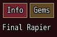
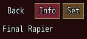
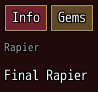
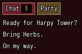
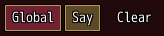
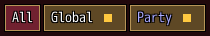
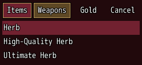

<!-- nav -->
[Mod Framework](../../README.md) › [UI components](README.md) › [Navigation](README.md#navigation)
<!-- /nav -->

# Tabs

`tabs` shows one page per `tab`, only the picked tab's page at a time. Tab and Shift+Tab step the
tabs nearest the focus, the pad's shoulders do the same, and a click picks one; the arrows stay in
the page. `tabs_header` holds parts before the tabs in their row, such as a Back button, and
`tabs_subheader` parts under that row and over every page, which stay where they are as the tabs
change.

## Examples

### Pages

<!-- example: tabs-pages -->
```ruby
tabs bind: :page do
  tab "Info", id: :info do
    text item_name
  end
  tab "Gems", id: :gems do
    text gem_names
  end
end
```


### A Back button before the tabs

<!-- example: tabs-header -->
```ruby
tabs do
  tabs_header do
    button "Back", on_click: :close
  end
  tab "Info" do
    text item_name
  end
  tab "Set" do
    text set_bonus
  end
end
```


### What every page is about, under the tabs

<!-- example: tabs-subheader -->
```ruby
tabs bind: :page do
  tabs_subheader do
    text item_type, typo: :caption, color: :dim
  end
  tab "Info", id: :info do
    text item_name
  end
  tab "Gems", id: :gems do
    text gem_names
  end
end
```


### Badges and a tab that comes and goes

<!-- example: tabs-badge -->
```ruby
tabs do
  tab "Chat", badge: -> { unread } do
    list messages
  end
  if in_party
    tab "Party" do
      list members, text: :name
    end
  end
end
```


### A bar alone

<!-- example: tabs-bar -->
```ruby
stack row: true do
  tabs pages: false, bind: :channel do
    tab "Global", id: :global
    tab "Say", id: :say
  end
  button "Clear", on_click: -> { clear }
end
```


### A bar of colored tabs with dots

<!-- example: tabs-dots -->
```ruby
tabs pages: false, bind: :channel do
  tab "All", id: :all
  tab "Global", id: :global, badge: -> { unread.include?(:global) }
  tab "Party", id: :party, color: [170, 170, 255], badge: -> { unread.include?(:party) }
end
```


`badge: true` draws a dot, such as for a chat that holds lines the player has not read. A tab with
`color:` writes its title in that color and fills its plate with it while picked.

### A bar alone over the list it fills

<!-- example: tabs-bar-enter -->
```ruby
stack row: true do
  tabs pages: false, enter: true, bind: :kind do
    tab "Items", id: :items
    tab "Weapons", id: :weapons
  end
  button "Gold", on_click: -> { offer_gold }
  button "Cancel", on_click: :close
end
list bag, text: :name, bind: :picked
```


Left and Right walk the tabs and the buttons as one row. With `enter: true`, confirm or a click on
a tab picks it and hands the focus to the part under the bar, here the list the tab fills; Down goes
there too. Cancel in the list comes back to the tab.

## Params, events and keys

Every part also takes [the params every part takes](README.md#params-every-part-takes).

<!-- generated: tabs -->
Tabs over one page each; only the picked tab's page shows. Each page is a tab, tabs_header holds parts before the tabs in their row, such as a Back button, and tabs_subheader parts under that row that stay as the tabs change.

Written `tabs ...` with a `do ... end` block of markup.

| Param | Takes | Default | Live | About |
|---|---|---|---|---|
| `bind:` | the name of a state |  |  | a state that holds the picked tab, both ways: its id:, else its place from 0 |
| `pages:` | true, false | `true` |  | false makes a bar of tabs alone, whose tabs the arrows walk with the parts beside them |
| `wrap:` | true, false | `false` |  | the tabs go on in a new row when their row is full, such as many tabs in a narrow window |
| `enter:` | true, false | `false` |  | a tab picked moves the focus into its page; on a bar alone, into the part under the bar, such as the list the tab fills |
| `arrows:` | true, false | `false` |  | Left and Right step the tabs too, wherever the focus has no use for them |
| `spacing:` | `0`, `1`, `2`, `3`, `4`, `5`, `6` | `1` |  | room between the row of tabs and the page, 4 px a unit |

| Event | Tells |
|---|---|
| `on_change` | the tab the player picked: its id:, else its place from 0 |

**Keys:** Tab and Shift+Tab step the tabs nearest the focus, round at either end; the arrows stay in the page

**Pad:** the shoulders step the tabs nearest the focus; tabs that show a single tab pass them on, such as to the window's on_page

**Mouse:** a click on a tab picks it

**Places:** `tabs_header` (parts before the tabs), `tabs_subheader` (parts under the tabs, over every page), each `tab` by its id
<!-- /generated -->

### Tab

<!-- generated: tab -->
One tab of tabs and its page, a column of parts.

Written `tab title, ...` with a `do ... end` block of markup.
It goes inside `tabs`.

| Param | Takes | Default | Live | About |
|---|---|---|---|---|
| `title:` | a text |  | yes | the tab's text |
| `badge:` | any value |  | yes | a count above 0 on a plate at the tab's end, "9+" above 9; true shows a dot |
| `color:` | a color name such as :primary or :rainbow, "#RRGGBB", [r, g, b] or a game text color such as 2 |  |  | the tab's own color: its text, and its plate while it is picked |
| `icon:` | an IconSet index, a name UI.icon gave one, or { file: "Graphics/Pictures/x" } |  |  | an icon drawn before its text |
| `spacing:` | `0`, `1`, `2`, `3`, `4`, `5`, `6` | `1` |  | room between the parts of its page, 4 px a unit |
<!-- /generated -->

### Tabs header

<!-- generated: tabs_header -->
The parts before the tabs in their row, such as a Back button.

Written `tabs_header ...` with a `do ... end` block of markup.
It goes inside `tabs`.
<!-- /generated -->

### Tabs subheader

<!-- generated: tabs_subheader -->
The parts under the row of tabs and over every page, which stay where they are as the tabs change, such as what every page is about.

Written `tabs_subheader ...` with a `do ... end` block of markup.
It goes inside `tabs`.
<!-- /generated -->

<!-- nav -->
---

← [Expansion panels](expansion_panels.md) · [All components](README.md) · [Menu](menu.md) →
<!-- /nav -->
