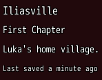
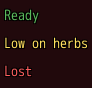
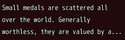
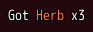
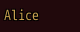
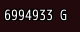
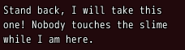
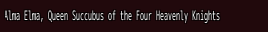
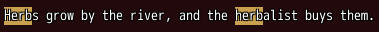

<!-- nav -->
[Mod Framework](../../README.md) › [UI components](README.md) › [Display](README.md#display)
<!-- /nav -->

# Text

`text` is a line of text, in a size and weight from the theme (`typo:`) and a color.

## Examples

### Sizes

<!-- example: text-typo -->
```ruby
text "Iliasville", typo: :h6
text "First Chapter", typo: :subtitle1
text "Luka's home village.", typo: :body1
text "Last saved a minute ago", typo: :caption
```


### Colors

<!-- example: text-color -->
```ruby
text "Ready", color: :success
text "Low on herbs", color: :warning
text "Lost", color: :error
```


### Wrapped and cut

<!-- example: text-wrap -->
```ruby
text item_text, wrap: true, most_lines: 3, width: 240
```


### The text that fits

```ruby
text -> { gold = UI::Game.gold; ["Gold: #{gold} G", "#{gold} G", "#{gold / 1000}k"] }
```

Give `text` ever shorter texts, longest first: it shows the first that fits its line, measured in
pixels in its own font, and the last when none fits, cut. While a shorter text shows, the whole
text is its tooltip. The line takes the room of the longest text when it has it, so a shorter one
shows only where its stack or its HUD is narrower, as a gold counter in a HUD beside other parts.
It works on a line that neither wraps nor reads the game's text codes (`wrap:`, `most_lines:` and
`escapes:` take the first text). The texts may be live, as here, or plain:
`text ["Iliasville Inn", "Inn"]`. [progress](progress.md#the-text-that-fits) takes them the same
way.

### The game's text codes on a plate

<!-- example: text-plate -->
```ruby
text "Got \\C[2]Herb\\C[0] x3", escapes: true, plate: true
```


### Clicked

<!-- example: text-click -->
```ruby
text "Alice", color: :primary, on_click: -> { show(alice) }
```


### A live value

<!-- example: text-live -->
```ruby
text -> { "#{UI::Game.gold} G" }
```


### Lines of a height of their own

<!-- example: text-line-height -->
```ruby
text "Stand back, I will take this one! Nobody touches the slime while I am here.", typo: :body2, line_height: 18, wrap: true, width: 220
```


`line_height:` sets the height of each line in pixels, the text in its middle, never below an icon
the text draws; without it each line is as high as its `typo:` needs.

### Squeezed into its width

<!-- example: text-squeeze -->
```ruby
text "Alma Elma, Queen Succubus of the Four Heavenly Knights", typo: :body2, fit: :squeeze, width: 260
```


A line too wide for its room ends in "..." by default (`fit: :cut`). `fit: :squeeze` hands the whole
line to the game's `draw_text`, which draws it narrower into its width, as the game's own windows
draw a line too long, such as a name in a box of a fixed width. The game narrows a line to about
60% of its width at most and cuts off its end past that, without "...". It takes no `escapes:`.

`fit: :narrow` suits a name beside other parts in a row, such as a gem's name before the icons of
its elements in a tooltip: the name gives up its room first, draws narrower down to 85% of its
width and past that ends in "...", its whole text then its tooltip.

### A search highlighted

<!-- example: text-highlight -->
```ruby
text "Herbs grow by the river, and the herbalist buys them.", wrap: true, highlight: "herb"
```


`highlight:` draws a text on the theme's primary color, its letters in their own color and outline,
wherever it occurs, ignoring case, such as the words a search typed; a list and a table take it too.

## Params, events and keys

Every part also takes [the params every part takes](README.md#params-every-part-takes).

<!-- generated: text -->
A line of text.

Written `text text, ...`.

| Param | Takes | Default | Live | About |
|---|---|---|---|---|
| `text:` | a text, or an Array of ever shorter texts |  | yes | what it says, or an Array of ever shorter texts of which the first that fits its line shows, picked by its pixels; the whole text then becomes its tooltip |
| `typo:` | `:h6`, `:subtitle1`, `:subtitle2`, `:body1`, `:body2`, `:caption`, `:overline` | `:body1` |  | its size and weight |
| `color:` | a color name such as :primary or :rainbow, "#RRGGBB", [r, g, b] or a game text color such as 2 |  | yes | its color |
| `align:` | `:start`, `:center`, `:end` |  |  | where its lines sit in its width, and it across its stack |
| `wrap:` | true, false | `false` |  | breaks into lines that fit |
| `most_lines:` | a whole number, `:fill` |  |  | the most lines, or :fill for as many as its room holds; the last ends in ... and the whole text becomes its tooltip |
| `min_font_size:` | a whole number |  |  | it gets this small before it cuts; texts in one row share the smallest size |
| `fit:` | `:cut`, `:squeeze`, `:narrow` | `:cut` |  | what a line too wide for its room does: :cut ends it in ...; :squeeze hands it whole to the game's draw_text, which draws it narrower into its width as the game's own windows draw a line too wide; not with escapes:; :narrow gives up its room in a row first, then draws narrower, down to 85% of its width, and past that ends in ... with the whole text as its tooltip |
| `line_height:` | a whole number |  |  | the height of each of its lines in pixels, its text in their middle, never below an icon it draws; its typo:'s own by default |
| `plate:` | true, false | `false` |  | draws it on a dark plate as wide as its text, so it reads over a busy map |
| `escapes:` | true, false | `false` |  | draws the game's text codes, such as \C[2] for a color and \I[64] for an icon |
| `highlight:` | a text |  | yes | a text drawn on the theme's primary color, its letters in their own color and outline, wherever it occurs, ignoring case, such as the words a search typed |

| Event | Tells |
|---|---|
| `on_click` | nothing; it was clicked |

**Keys:** none

**Mouse:** a click tells on_click
<!-- /generated -->

<!-- nav -->
---

← [Options list](options_list.md) · [All components](README.md) · [Field](field.md) →
<!-- /nav -->
