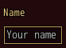
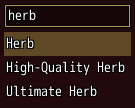
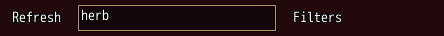
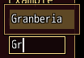
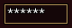
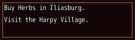
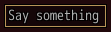
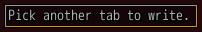

<!-- nav -->
[Mod Framework](../../README.md) › [UI components](README.md) › [Buttons and forms](README.md#buttons-and-forms)
<!-- /nav -->

# Text field

`text_field` is a field the player types into:
Shift, Caps Lock, AltGr, accents such as ê and Ctrl+V work, and the game's buttons and every mod's
hotkeys stay quiet while it types. Bind it to a state and the state keeps its text. Its first
value, `label:`, is a caption above it, as on every input. The first cancel stops typing; the next
one goes on as anywhere else in the window.

## Examples

### Bound to a state

<!-- example: text_field-bind -->
```ruby
text_field "Name", bind: :name, placeholder: "Your name", max_length: 12
```


### A search over a list

<!-- example: text_field-search -->
```ruby
text_field bind: :search, placeholder: "Search", steer: :items
list items.select { |item| item.name.downcase.include?(search.downcase) }, id: :items, text: :name, bind: :item
```


While the field types, Up, Down, Page Up and Page Down move the list's cursor and Enter picks its
row.

### A search in a bar of buttons

<!-- example: text_field-bar -->
```ruby
stack row: true do
  button "Refresh", id: :refresh, on_click: -> { refresh }
  text_field bind: :search, placeholder: "Search the items", leave_sides: true, width: 200,
                            on_submit: ->(_text) { part(:refresh).focus },
                            on_cancel: -> { self.search = ""; part(:refresh).focus }
  button "Filters", on_click: -> { self.filters_open = !filters_open }
end
```


With `leave_sides: true` Right at the end of the text goes on to Filters and Left at its start back
to Refresh, as along the buttons. `on_cancel` hears the first cancel, which stops the typing: here
it empties the search. Every part's handle takes `focus`, so `part(:refresh).focus` moves the focus
back onto the bar after Enter or cancel, as the mod browser's search does.

### Suggestions

<!-- example: text_field-completions -->
```ruby
text_field "Whisper to", bind: :to, completions: ["Alice", "Granberia", "Tamamo"]
```


The field offers the words that hold the last word typed anywhere, ignoring case, as "am" offers
Tamamo. For a match of your own, such as one that forgives typos, give a lambda instead: it gets the
word typed and answers the words, as in `completions: ->(word) { names_like(word) }`. Up and Down
move through the suggestions, Enter or Tab takes one: it replaces the last word typed, as in a chat,
and then `on_complete` tells which one was taken.

### A password

<!-- example: text_field-password -->
```ruby
text_field bind: :password, password: true, confirm_to_type: true
```


### Several lines

<!-- example: text_field-lines -->
```ruby
text_field bind: :note, lines: 3, width: 260
```


### Keys of its own

<!-- example: text_field-keys -->
```ruby
text_field bind: :line, placeholder: "Say something", keys: ["Alt+Left", "Alt+Right"],
           on_key: ->(key) { step_chat(key == "Alt+Left" ? -1 : 1) }
```


While it types, the field takes the keys `keys:` names and tells each to `on_key`, such as Alt with
Left or Right stepping a bar of tabs over a chat. With Alt in the name it takes the key only while
Alt is held, so Left without Alt still moves the caret.

### Read only

<!-- example: text_field-read-only -->
```ruby
text_field bind: :note, read_only: true, placeholder: "Pick another tab to write."
```


A read-only field takes the focus and shows its text, takes no typing and still tells its `keys:`.

### With a gamepad

A gamepad's A on a field opens the game's own letters in a box of their own, under the field's
label. The d-pad and A pick letters, B takes the last letter away as the game's name entry does,
and B on an empty text closes the letters with the field as it was. OK puts the text into the field
as Enter would. `letters: false` keeps a field off them, such as a search whose list A picks from.

## Params, events and keys

Every part also takes [the params every part takes](README.md#params-every-part-takes).

<!-- generated: text_field -->
A field the player types into, with the chat's text input: Shift, Caps Lock, AltGr, accented letters and Ctrl+V work, and the game's buttons and every mod's hotkeys stay quiet while it types.

Written `text_field label, ...`.

| Param | Takes | Default | Live | About |
|---|---|---|---|---|
| `label:` | a text |  | yes | a caption above it, as MudBlazor draws an input's label |
| `bind:` | the name of a state |  |  | a state that holds its text, both ways |
| `placeholder:` | a text |  | yes | a dim text it shows while it is empty, also while the player types, such as "Search" |
| `password:` | true, false | `false` |  | shows a * for each character |
| `lines:` | a whole number | `1` |  | its lines; with more than 1 it ends in ... while it does not type |
| `max_length:` | a whole number |  |  | the most characters it takes, 10,000 when not given |
| `allowed:` | any value |  |  | a Regexp of the characters it takes, such as /[0-9]/; any other plays the buzzer |
| `read_only:` | true, false | `false` |  | it takes the focus and shows its text but takes no typing |
| `confirm_to_type:` | true, false | `false` |  | the focus rests on it until confirm or a click starts typing; cancel then puts the text back |
| `letters:` | true, false | `true` |  | a gamepad's A opens the game's letter pages for it |
| `completions:` | an Array of words, or a lambda of the word typed answering them |  |  | words it offers for the last word typed: an Array, narrowed to the words that hold it anywhere, ignoring case, or a lambda of that word answering its own words; Up and Down move, Enter or Tab take one |
| `steer:` | a Symbol or a text |  |  | the id of a list in its window whose cursor Up, Down, Page Up, Page Down and Enter move while it types, as a search over a list; or of a log, which Up, Down, Page Up and Page Down scroll, as a chat's line over its log |
| `keys:` | an Array |  |  | names of keys it claims while it types, such as ["Alt+Up"], which tell on_key |
| `typing_help:` | a text |  |  | the help line's text while it types |
| `leave_sides:` | true, false | `false` |  | Right with the caret at the end of its text and Left at its start move the focus to the part beside it, as along a bar of buttons with a search among them |
| `required:` | any value |  |  | true, or the error to show, such as "Name the formation": an empty value is an error, "Required" by default |
| `validate:` | a lambda of one item, or its method name |  |  | a lambda of its value answering the error to show, or nil while the value is fine, such as ->(name) { "Too short" if name.size < 3 }; a method name calls that method of the component |

| Event | Tells |
|---|---|
| `on_change` | its text, as the player typed it |
| `on_submit` | its text, as Enter gave it; a field that steers a list picks the list's row instead, and one that offers completions takes the lit one first |
| `on_revert` | nothing; a field with confirm_to_type: put its text back on cancel |
| `on_key` | the name of a key of keys: pressed while it types |
| `on_complete` | the completion taken and its place |
| `on_type` | nothing; a field with confirm_to_type: started typing |
| `on_refuse` | nothing; it could not start typing, as its text box did not open |
| `on_cancel` | nothing; the first cancel stopped its typing, such as to empty a search |

**Keys:** typing, Left, Right, Home, End and Ctrl+V; Enter submits, as does a key bound to confirm that it does not type; the first cancel stops typing and the next goes on; Up and Down leave a field of one line, and with leave_sides: Right at the end of its text and Left at its start; Tab goes into the window's first field and back while the window shows no tabs

**Pad:** A opens the game's letter pages unless letters: false, titled by its label: or else the caption of the field it sits in, where B takes the last letter away and closes them on an empty text; B as cancel

**Mouse:** a click puts the caret there and types
<!-- /generated -->

<!-- nav -->
---

← [Button](button.md) · [All components](README.md) · [Autocomplete](autocomplete.md) →
<!-- /nav -->
