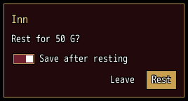
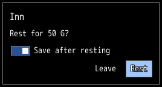
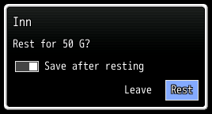

<!-- nav -->
[Mod Framework](../../README.md) › [UI components](README.md) › [Looks](README.md#looks)
<!-- /nav -->

# Themes

Every window, dialog and HUD of the framework and its mods wears one look, which the player picks
on the Interface Look row of Options > Mods: Monarch (the default), Legacy, Game's Default, then
the presets mods add. Look on Game Windows, the row under it, says whether the game's own windows
wear it too. Your parts wear the player's look with no call, and no mod sets the look in use.

## The looks

Each picture shows the same window in one look.

### Monarch

<!-- example: themes-monarch -->
```ruby
window "Inn", width: 260, theme: "Monarch" do
  text "Rest for 50 G?"
  switch "Save after resting", bind: :save_after
  stack row: true, justify: :end do
    button "Leave", on_click: :close
    button "Rest", variant: :filled, on_click: -> { rest }
  end
end
```


Maroon with a gold edge in a black rim, its filled buttons a muted gold.

### Legacy

<!-- example: themes-legacy -->
```ruby
window "Inn", width: 260, theme: "Legacy" do
  text "Rest for 50 G?"
  switch "Save after resting", bind: :save_after
  stack row: true, justify: :end do
    button "Leave", on_click: :close
    button "Rest", variant: :filled, on_click: -> { rest }
  end
end
```


Black glass with a grey edge, its filled buttons light blue.

### Game's Default

<!-- example: themes-game -->
```ruby
window "Inn", width: 260, theme: "Game's Default" do
  text "Rest for 50 G?"
  switch "Save after resting", bind: :save_after
  stack row: true, justify: :end do
    button "Leave", on_click: :close
    button "Rest", variant: :filled, on_click: -> { rest }
  end
end
```


The game's own window skin in its Window Color.

## A preset of your own

`UI.preset` adds a preset to the player's Interface Look row. `from:` names the preset it starts
from, and `palette:` sets the colors it changes; everything else it takes from `from:`. Call it
once, as your mod loads:

```ruby
UI.preset "Moonlight", from: "Legacy", palette: { primary: "#B08CFF", back: [20, 16, 40, 235] }
```

A palette sets roles, each `"#RRGGBB"`, `[r, g, b]` or `[r, g, b, a]`:

| Roles | What they color |
|---|---|
| `primary`, `secondary`, `tertiary` | filled parts and accents; a filled button takes `primary` |
| `info`, `success`, `warning`, `error` | the severities of alerts and toasts |
| `text`, `dim`, `gold`, `own`, `ally`, `system`, `default` | texts: plain, faint, gold amounts, the player's own name, allies and labels; `default` follows `text` |
| `text_dark`, `text_light` | the two texts a part with `contrast: true` writes on a fill, whichever reads better there; a dark text gets `text_light` round it |
| `back`, `plate`, `picked`, `field`, `heading`, `edge`, `track`, `rim`, `title`, `well`, `tab` | the boxes: the window's back, plates, the row picked, fields, headings, the edge, tracks, the rim, titles, wells and tabs |

A preset that starts from Game's Default takes the boxes and `primary` and `tertiary` from the game's
window unless it sets them. A preset name another mod gave first is refused.

## Colors and icons of your own

`UI.color` names a color for every color param and the text code `\C[name]`, with a color of its own
in some presets if you like; [Colors](colors.md) tells all it takes. `UI.icon` names an IconSet
index, or a picture, for every part's `icon:`:

```ruby
UI.color :rare_loot_legendary, [181, 162, 21], "Legacy" => "#FFD878"
UI.icon :rare_loot_star, 125
UI.icon :rare_loot_halo, { file: "Graphics/Pictures/halo" }
# In render:
text "Angel Halo", color: :rare_loot_legendary
button "Claim", icon: :rare_loot_star, on_click: -> { claim }
```

Color and icon names are shared by every mod, so start them with your mod's name.

## Defaults of your own parts

`UI.defaults` sets defaults for a built-in in your own mod's parts: looks and sizes, never an id, a
handler or a text. A param a call gives wins, and other mods' parts never take them.
`:severity_icons` gives each severity the icon your alerts and toasts show unless they name one:

```ruby
UI.defaults :button, variant: :outlined
UI.defaults :alert, dense: true
UI.defaults :severity_icons, warning: 56, error: :rare_loot_star
# In render:
button "Leave", on_click: :close                    # outlined
alert "The chest is locked.", severity: :warning    # dense, with icon 56
```

## Text on fills

Every text draws in the plain text color (white in Monarch) with a black outline, on a filled
button, a chip, a tab or a bar too. `contrast: true` on a part writes its texts on a fill, and
those of every part inside it, in `text_dark` or `text_light`, whichever reads better on the fill;
a dark text then gets `text_light` round it instead of the black outline. `text_color:` and
`outline:` set by hand win. Give it to your own parts through `UI.defaults`:

```ruby
UI.defaults :button, contrast: true
# In render:
button "Buy", variant: :filled, color: :gold, on_click: -> { buy }   # a dark text on the gold
```

## A look pinned on your own windows

`theme:` on a part draws it and what it holds in one preset, whichever look the player picked.
Pin one only on your own windows, such as a screen that should keep the look it was made in:

```ruby
window "Iliasville", theme: "Legacy" do
  text "Luka's home village."
end
```

`theme: :game` draws a part as the game's own windows look now: in the game's window skin, or in
the player's look while Look on Game Windows is On. Another mod's windows and the framework's
screens keep the player's look.

<!-- nav -->
---

← [Colors](colors.md) · [All components](README.md)
<!-- /nav -->
