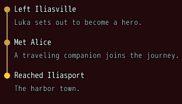
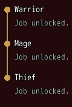

<!-- nav -->
[Mod Framework](../../README.md) › [UI components](README.md) › [Display](README.md#display)
<!-- /nav -->

# Timeline

`timeline` shows entries under each other in the order things happened, as MudBlazor's timeline:
the story's chapters, the jobs a character unlocked, the steps of a quest. Each `timeline_item`
has a dot on a line that joins it to the entries before and after, its title beside the dot and
its `text:` under the title in small dim text, wrapped. `color:` colors the dot, primary by
default. The entries take neither the keys nor the pointer; put the timeline in a `paper` with
`scroll: :vertical` when it grows long.

## Examples

### Story points

<!-- example: timeline-story -->
```ruby
timeline do
  timeline_item "Left Iliasville", text: "Luka sets out to become a hero."
  timeline_item "Met Alice", text: "A traveling companion joins the journey."
  timeline_item "Reached Iliasport", text: "The harbor town.", color: :secondary
end
```


### Jobs unlocked

<!-- example: timeline-jobs -->
```ruby
timeline do
  ["Warrior", "Mage", "Thief"].each do |job|
    timeline_item job, text: "Job unlocked.", key: job
  end
end
```


## Params, events and keys

Every part also takes [the params every part takes](README.md#params-every-part-takes).

<!-- generated: timeline -->
Entries under each other in the order things happened, as MudBlazor's timeline, such as the story's chapters or the jobs unlocked: each a dot on a line, a title and a text.

Written `timeline ...` with a `do ... end` block of markup.
<!-- /generated -->

<!-- generated: timeline_item -->
One entry of a timeline: a dot, its title and a text under it.

Written `timeline_item title, ...`.
It goes inside `timeline`.

| Param | Takes | Default | Live | About |
|---|---|---|---|---|
| `title:` | a text |  | yes | what happened, such as "Left Iliasville" |
| `text:` | a text |  | yes | more about it, in small text under the title |
| `color:` | a color name such as :primary or :rainbow, "#RRGGBB", [r, g, b] or a game text color such as 2 |  |  | the dot's color; the theme's primary color by default |

**Keys:** none

**Mouse:** none
<!-- /generated -->

<!-- nav -->
---

← [Chip set](chip_set.md) · [All components](README.md) · [Alert](alert.md) →
<!-- /nav -->
