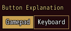
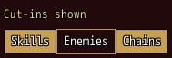
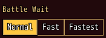
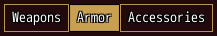
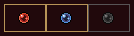

<!-- nav -->
[Mod Framework](../../README.md) › [UI components](README.md) › [Buttons and forms](README.md#buttons-and-forms)
<!-- /nav -->

# Toggle group

`toggle_group` is a row of joined buttons that the player turns on, as MudBlazor's toggle group,
such as one of the game's settings with two or three ways. Each `toggle_item` is outlined while off
and filled in the group's `color:` while on. Bind the group to a state and the state keeps the
value on.

- Without `multi:` one item is on: a click or confirm turns another on, and one already on stays on.
- With `multi: true` each item turns on and off, and the state holds the values on, an Array in the
  items' order.
- Left and Right move among the items, as among any buttons in a row.
- With `number_keys: true` the digits 1 to 9 press the first to the ninth item, also while a
  field of its window types that takes no digits.

A filter the player turns on and off is a toggle group, a checkbox or a switch; chips only show.

## Examples

### One way of a few

<!-- example: toggle_group-bind -->
```ruby
toggle_group "Button Explanation", bind: :key_text do
  toggle_item "Gamepad", value: :gamepad
  toggle_item "Keyboard", value: :keyboard
end
```


### Several on at once

<!-- example: toggle_group-multi -->
```ruby
toggle_group "Cut-ins shown", bind: :cut_ins, multi: true do
  toggle_item "Skills", value: :skill
  toggle_item "Enemies", value: :enemy
  toggle_item "Chains", value: :chain
end
```


### In a color of its own

<!-- example: toggle_group-color -->
```ruby
toggle_group "Battle Wait", bind: :wait, color: :secondary do
  toggle_item "Normal", value: 100
  toggle_item "Fast", value: 50
  toggle_item "Fastest", value: 25
end
```


`color:` fills the items on; their text stays the plain text color, or with `contrast: true` takes
the dark or the light text, whichever reads better on the fill.

### Filters over a list

<!-- example: toggle_group-filters -->
```ruby
toggle_group bind: :kinds, multi: true do
  toggle_item "Weapons", value: :weapon
  toggle_item "Armor", value: :armor
  toggle_item "Accessories", value: :accessory
end
```


None on stands for no filter: keep every row of the list while the state is empty.

### Turned on by the digits

<!-- example: toggle_group-digits -->
```ruby
toggle_group bind: :colors, multi: true, number_keys: true do
  toggle_item "", icon: 3473, value: :red, tooltip: "Red gems"
  toggle_item "", icon: 3479, value: :blue, tooltip: "Blue gems"
  toggle_item "", icon: 3476, value: :green, tooltip: "Green gems", disabled: true
end
```


1 turns red on and off, 2 blue; 3 buzzes, since its item is greyed out. An item of an icon alone
shows it in its middle. The Equipment Window's gem dialog filters its colors this way.

## Params, events and keys

Every part also takes [the params every part takes](README.md#params-every-part-takes).

<!-- generated: toggle_group -->
Buttons joined in a row that the player turns on, as MudBlazor's toggle group, such as the game's Button Explanation; each is a toggle_item.

Written `toggle_group label, ...` with a `do ... end` block of markup.

| Param | Takes | Default | Live | About |
|---|---|---|---|---|
| `label:` | a text |  | yes | a caption above it, as MudBlazor draws an input's label |
| `bind:` | the name of a state |  |  | a state that holds the value of the item on, both ways; with multi: true the values on, an Array |
| `multi:` | true, false | `false` |  | any number of items may be on; false keeps one on, and a click on it keeps it on |
| `color:` | a color name such as :primary or :rainbow, "#RRGGBB", [r, g, b] or a game text color such as 2 |  |  | the fill of the items on; the theme's primary color by default |
| `number_keys:` | true, false | `false` |  | the digits 1 to 9 press the first to the ninth item, also while a field of its window types that takes no digits |
| `required:` | any value |  |  | true, or the error to show, such as "Name the formation": an empty value is an error, "Required" by default |
| `validate:` | a lambda of one item, or its method name |  |  | a lambda of its value answering the error to show, or nil while the value is fine, such as ->(name) { "Too short" if name.size < 3 }; a method name calls that method of the component |

| Event | Tells |
|---|---|
| `on_change` | the value of the item the player turned on; with multi: true the values on now, in the items' order |

**Keys:** Left and Right move among the items; confirm turns one on, or with multi: true on or off; with number_keys: the digits too

**Pad:** the d-pad's Left and Right move, A turns one on or off

**Mouse:** a click turns an item on, or with multi: true on or off
<!-- /generated -->

### Toggle item

<!-- generated: toggle_item -->
One item of a toggle_group.

Written `toggle_item text, ...`.
It goes inside `toggle_group`.

| Param | Takes | Default | Live | About |
|---|---|---|---|---|
| `text:` | a text |  |  | what it says |
| `icon:` | an IconSet index, a name UI.icon gave one, or { file: "Graphics/Pictures/x" } |  |  | an icon before its text, or alone in its middle without one |
| `value:` | any value |  |  | what stands for it in the toggle group's bound value; its text by default |
<!-- /generated -->

<!-- nav -->
---

← [Radio group](radio_group.md) · [All components](README.md) · [Form](form.md) →
<!-- /nav -->
