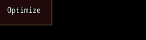
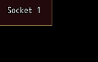
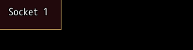

<!-- nav -->
[Mod Framework](../../README.md) › [UI components](README.md) › [Display](README.md#display)
<!-- /nav -->

# Tooltip

`tooltip` wraps a part and shows markup while the pointer rests on it, or under it while the keys
focus it, such as a gem with what it adds. For a tooltip of plain text you need no tooltip part:
every part takes `tooltip: "..."`.

## Examples

### A plain text

<!-- example: tooltip-text -->
```ruby
button "Optimize", tooltip: "Equip the strongest items", on_click: -> { optimize }
```


### Markup

<!-- example: tooltip-markup -->
```ruby
tooltip content: -> { text "Gem of Attack", typo: :subtitle2; text "Attack +10%", color: :success } do
  button "Socket 1", on_click: -> { pick_gem(0) }
end
```


### On a side

<!-- example: tooltip-side -->
```ruby
tooltip side: :right, content: -> { text "Gem of Fire Enhancement"; text "Fire damage +15%", typo: :caption } do
  button "Socket 1", on_click: -> { pick_gem(0) }
end
```


With `side:` it shows on that side of the part, flush with the part's left or top, both for the
pointer and for the keys. Where the screen leaves it no room there, it shows on the opposite side,
else below or above the part, so it never covers the part.

## Params, events and keys

Every part also takes [the params every part takes](README.md#params-every-part-takes).

<!-- generated: tooltip -->
Wraps a part and shows markup while the pointer rests on it, or while the keys focus it, such as a gem with what it adds; a plain text needs no tooltip part, as every part takes tooltip:.

Written `tooltip ...` with a `do ... end` block of markup.

| Param | Takes | Default | Live | About |
|---|---|---|---|---|
| `content:` | markup as a lambda |  |  | the markup it shows, such as -> { text "Gem of Attack" } |
| `side:` | `:top`, `:bottom`, `:left`, `:right` |  |  | the side of the part inside it shows on, flush with its start; without side: beside the pointer, and under the part as the keys focus it |

**Keys:** none of its own; it shows under the part inside, or on its side:, as the keys focus it

**Mouse:** it shows beside the pointer, or on its side: of the part inside, once the pointer rests on the part inside
<!-- /generated -->

<!-- nav -->
---

← [Arrow](arrow.md) · [All components](README.md) · [Key help](key_help.md) →
<!-- /nav -->
