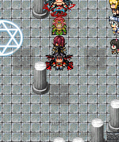
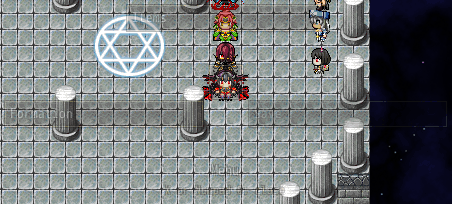
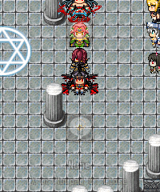

<!-- nav -->
[Mod Framework](../../README.md) › [UI components](README.md) › [Roots](README.md#roots)
<!-- /nav -->

# Wheel

`wheel` spreads up to eight choices evenly over the eight directions around the player, clockwise
from the top, with a middle. The arrows point at a choice like a joystick: two arrows held point
at the direction between them, and letting go keeps the pick. Confirm takes the pick, and the wheel
closes and tells `on_submit`. The game's cancel key, Numpad 0 and a click outside close it without
a choice. The pointer picks the choice under it and a click takes it. Open the component whose
`render` describes it with `UI.open`; its block gets the choice taken, or nil.

A wheel opens only on a free map, where no event, message or transfer runs (`if:`), and closes as
soon as the map is no longer free. While it is open it holds the game's buttons, so the player
stands still. It fades in and out.

## Examples

### A ring

<!-- example: wheel-ring -->
```ruby
wheel choices: ["Wave", "Bow", "Cheer", "Sit"], none_text: "None", on_submit: ->(choice) { gesture(choice) }
```


Without `center:` the wheel opens with nothing picked, and the line under it says `none_text:`.

### Boxes with a middle

<!-- example: wheel-boxes -->
```ruby
wheel look: :boxes, center: { text: "Menu", icon: 187 }, on_submit: ->(choice) { start(choice) },
      choices: -> { [{ text: "Items" }, { text: "Save", disabled: !save_allowed?, tooltip: "Saving is off here." }, { text: "Formation" }] },
      on_refuse: ->(choice) { Mod_Framework.toast choice[:tooltip] }
```


With `center:` the wheel opens on the middle, and a direction without a choice picks the middle
again. `look: :boxes` draws wide boxes with their texts in a column at each
side and one above and one below. A lambda for `choices:` is asked every frame while the wheel is
open; it draws anew only when the answer changes, and the pick stays on its direction. A choice
with `disabled: true` is greyed out; taking it buzzes, keeps the wheel open and tells `on_refuse`.

### Pictures from a sheet

<!-- example: wheel-balloons -->
```ruby
wheel choices: [{ text: "Heart", bitmap: UI.sheet_cell("Balloon", 7, 3, 32) },
                { text: "Idea", bitmap: UI.sheet_cell("Balloon", 7, 8, 32) }], none_text: "None"
```


`UI.sheet_cell(file, column, row, size)` cuts one cell of a sheet in `Graphics/System`, such as a
balloon of `Balloon.png`, and keeps it once made.

### Opened by a hotkey

```ruby
Mod_Framework::Hotkeys.define(:quick_menu_wheel, key: "G", name: "[Quick Menu] Wheel")

class QuickWheel < UI::Component
  hotkey :quick_menu_wheel

  def render
    wheel choices: ["Items", "Save"], on_submit: ->(choice) { start(choice) }
  end
end
```

The hotkey a component class declares opens the wheel on a free map and closes it again, from the
moment the mod loads, and the hint under the wheel names it after the cancel keys. `hotkey:` only
changes the hotkey the hint names; the log says so when it differs from the class's.

## Params, events and keys

Every part also takes [the params every part takes](README.md#params-every-part-takes).

<!-- generated: wheel -->
Up to eight choices spread evenly over the eight directions around the player, clockwise from the top, and a middle; the arrows point at one like a joystick and confirm takes it. UI.open opens a component whose top part is one.

Written `wheel ...`.
Opened by `UI.open`.

| Param | Takes | Default | Live | About |
|---|---|---|---|---|
| `choices:` | an Array of up to eight choices, each a text or { text:, icon:, bitmap:, disabled:, tooltip:, data: }, or a lambda without arguments answering them | `[]` |  | its choices, up to eight; a lambda is asked every frame while it is open, it draws anew only when they change, and the pick stays on its direction; it shows the first eight of more a lambda answers and the log says so once |
| `center:` | a choice, a text or { text:, icon:, bitmap:, disabled:, tooltip:, data: }, or a lambda without arguments answering one |  |  | the middle's choice, picked as the wheel opens and by a direction without a choice; without one nothing is picked as it opens |
| `look:` | `:ring`, `:boxes` | `:ring` |  | :ring draws square boxes in a ring, :boxes wide boxes with their texts in a column at each side, one above and one below |
| `none_text:` | a text | `""` |  | what the line under it says while nothing is picked, such as "None" |
| `follow:` | :player, a map character such as an event, a sprite, or an event's id on this map | `:player` |  | the map character it lies around, on its middle; nil for the screen's middle |
| `at:` | [x, y] |  |  | an exact spot [x, y] on the screen for its middle instead of follow: |
| `if:` | a lambda answering true or why not, or :map_free | `:map_free` |  | asked every frame; anything but true refuses the open and closes it, the answer its reason; :map_free while no event, message or transfer runs on the map |
| `hotkey:` | the name of a hotkey of Mod_Framework::Hotkeys |  |  | the hotkey of Mod_Framework::Hotkeys its hint names, by default the one its component class declares with hotkey :name; only that declared hotkey opens and closes it, from the moment the mod loads |
| `fade:` | true, false | `true` |  | it fades in as it opens and out as it closes |

| Event | Tells |
|---|---|
| `on_open` | once it shows |
| `on_close` | why it closed: :submit, :cancel, :outside, :hotkey, :scene, :script or the gate's answer |
| `on_submit` | the choice taken, as given: one of choices:, or center: for the middle |
| `on_refuse` | the player took a choice with disabled: true, which buzzed and kept the wheel open: the choice |
| `on_gone` | nothing of it shows any more, once it faded out after it closed, such as for a screenshot without it |

**Keys:** the arrows point like a joystick, two at once at the direction between them, and letting go keeps the pick; confirm takes the pick; a choice with disabled: true buzzes and stays open; the game's cancel key and Numpad 0 close it; the hotkey its class declares closes it; a press held from before it opened counts only once let go

**Pad:** the d-pad and the stick point; A takes; B closes

**Mouse:** pointing at a choice picks it, a click takes it, a click outside closes it
<!-- /generated -->

<!-- nav -->
---

← [Popover](popover.md) · [All components](README.md) · [Stack](stack.md) →
<!-- /nav -->
