<!-- nav -->
[Mod Framework](../../README.md) › [UI components](README.md) › [Roots](README.md#roots)
<!-- /nav -->

# Window

`window` is the frame of a screen of your mod. While it is open it holds the game's buttons, so the
map stands still. Cancel, the mouse, the gamepad and Alt-drag work without code. Open the
component whose `render` describes it with `UI.open`.

## Without a class

A small window without state or methods of its own needs no class: `UI.open` takes its render as
a block. Inside it `self` is a component, so `on_click: :close` works, and your mod's own methods
too. Once the window needs state or methods of its own, make it a class.

```ruby
UI.open do
  window "Purse", width: 200 do
    text "#{UI::Game.gold} G", align: :end
    button "OK", on_click: :close
  end
end
```

## Examples

### A plain window

<!-- example: window-plain -->
```ruby
window "Iliasville" do
  text "Luka's home village."
end
```
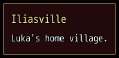

### Buttons at the bottom

<!-- example: window-buttons -->
```ruby
window "Leave the dungeon?", width: 280 do
  text "A Thread of Guidance takes the party back to the entrance.", wrap: true
  stack row: true, justify: :end do
    button "Stay", on_click: :close
    button "Leave", variant: :filled, on_click: -> { use_thread }
  end
end
```
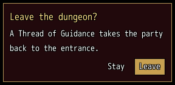

### Docked to the left edge

<!-- example: window-docked -->
```ruby
window "Places", dock: :left, width: 240 do
  list towns, bind: :town
end
```
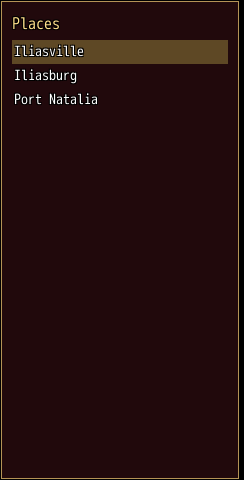

### As high as the screen

<!-- example: window-screen -->
```ruby
window "Equipment", height: :screen, min_size: [0, 400], resizable: :height do
  list slots, bind_index: :slot
end
```
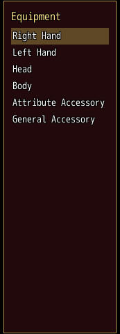

### Without a frame

<!-- example: window-frameless -->
```ruby
window nil, frame: false, width: 360 do
  paper do
    text "Mods", typo: :h6
    text "3 mods", typo: :caption, color: :dim
  end
  paper do
    list ["Map Display", "Level Cap", "Now Playing"], bind: :mod
  end
end
```
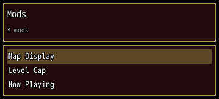

With `frame: false` the window draws neither its frame nor its background and keeps no room for
them, so the papers it holds are what shows. The mod browser is such a window as large as the
screen (`width: :screen, height: :screen`), its bar and its mods each a paper of their own.

### Beside a game window

<!-- example: window-beside -->
```ruby
window "Details", beside: "Window_MenuCommand", side: :right do
  text "Shown next to the menu's commands."
end
```
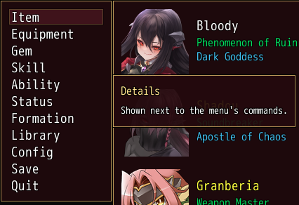

### Over a game window, in its place

<!-- example: window-cover -->
```ruby
window nil, cover: "Window_Config" do
  options_list mod: "Mod Framework", help_window: SceneManager.scene.instance_variable_get(:@help_window)
end
```
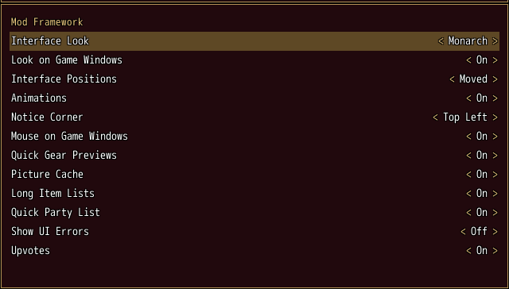

`cover:` names a game window by its class name, here the list of the game's Options, or gives the
window itself. The window lies exactly over it, at its place and in its size, and the game window
hides while the window is open and shows again as it closes; the game's own scripts still read it
as shown. Options > Mods lies over the game's options list this way. `cover: true` on a
[dialog](dialog.md) lies over the window that opened it instead.

### One cursor with a game window

<!-- example: window-join -->
```ruby
window "Records", beside: "Window_MenuCommand", side: :right, join: true do
  list ["Battles", "Gold"], on_submit: ->(page) { open_page(page) }
end
```
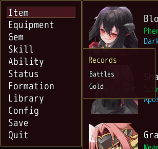

With `join: true` the window and the game window share one cursor. The game window keeps the keys
as the window opens; the arrow toward the window, or the pointer moving onto it, hands it the keys,
and the game window waits without its cursor, keeping its place; the arrow back, or the pointer
moving onto the game window, hands them back. Cancel does what it does in the game window, such as closing the menu, and on the
title, where it does nothing, the window stays open. L, R, Page Up and Page Down do nothing in it,
as on the title's commands. A window or a dialog its handler opens, such as
a screen the title's Mods box opens, hides both until it closes; then the window takes the keys
back on the row that opened it.

### Asking before it closes

<!-- example: window-ask -->
```ruby
window "Shop", on_cancel: -> { ask_to_leave } do
  list goods, bind: :picked
end
```
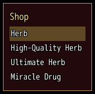

`on_cancel` answering false keeps the window open without the cancel sound; the handler may open
a question first, or buzz while something runs that cancel waits for.

### In a menu scene of its own

<!-- example: window-menu -->
```ruby
window "Inn", menu: true, movable: false do
  text "A rest heals the whole party."
  button "Rest", on_click: -> { rest_party }
end
```
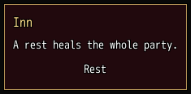

With `menu: true` a window opened on the map opens over the game's blurred menu background, and the
map, its events and its timers wait behind it as they do behind the game's menu. As it closes, the
game goes back to the map. Opened inside a menu, it opens in place. `UI.open` answers its handle at
once; the window shows from the next frame on.

### Holding the game's buttons only while typing

<!-- example: window-typing -->
```ruby
window "Party chat", anchor: :bottom_left, width: 320, captures: :typing, on_cancel: -> { false } do
  log -> { lines }, rows_shown: 4
  text_field bind: :line, placeholder: "Say something", on_submit: ->(text) { say(text) }
end
```
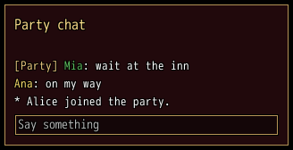

With `captures: :typing` the window stays on the screen while the player walks, and holds the
game's buttons only while its line types, such as a chat. The first cancel stops the typing: the
line lets go of the focus, so every key reaches the game again, and `on_cancel` is asked; answering
false keeps the window open.

### Resting under the game's windows

<!-- example: window-rest -->
```ruby
window nil, anchor: :bottom_left, width: 320, captures: :typing, frame: typing, layer: (typing ? :windows : :hud),
            mouse: (typing ? :all : :none), on_cancel: -> { self.typing = false; false } do
  log -> { lines }, rows_shown: 3
  text_field(bind: :line, placeholder: "Say something", on_submit: ->(text) { say(text) }) if typing
end
```
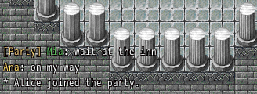

`layer:` puts the window in a layer of the screen: `:windows` with the framework's windows, `:over`
above the game's windows but under the framework's windows and dialogs, or `:hud` with the HUD
parts under the game's windows, such as the message box, drawn without its frame. `mouse:` says
where it takes the pointer: `:all`, `:parts` (its buttons and the parts with a tooltip) or `:none`.
Both may change while the window shows, as `frame:` may. Here the log of recent lines rests under
the message box while the player walks and lets the pointer through; once the player opens it to
type, it rises framed above everything, and cancel lays it back down.

## Params, events and keys

Every part also takes [the params every part takes](README.md#params-every-part-takes).

<!-- generated: window -->
A window that holds the game's buttons while it is open. UI.open opens a component whose top part is one.

Written `window title, ...` with a `do ... end` block of markup.
Opened by `UI.open`.

| Param | Takes | Default | Live | About |
|---|---|---|---|---|
| `at:` | [x, y] |  | yes | an exact spot [x, y] on the screen instead of its zone, rarely needed; a lambda is read every frame, and it jumps to a new spot the frame the answer changes |
| `movable:` | true, false | `true` |  | false keeps the player from moving it with Alt |
| `shown_in:` | scene classes or patterns of their names |  |  | the only scenes it shows in; elsewhere it fades out without closing and keeps its place |
| `place_name:` | a text |  |  | the name the player sees for its stored place |
| `if:` | a lambda answering true or why not, or :map_free |  |  | asked every frame; anything but true closes it, the answer its reason |
| `z:` | a whole number |  |  | which root lies above which within the band of its layer, 0 by default |
| `anchor:` | `:top_left`, `:top`, `:top_right`, `:left`, `:center`, `:right`, `:bottom_left`, `:bottom`, `:bottom_right` | `:center` |  | the zone of the screen it sits in; a dialog without one sits over the window that opened it |
| `dock:` | `:left`, `:right`, `:top`, `:bottom` |  |  | the edge of the screen it takes the whole length of, such as a full-height side window |
| `beside:` | a selector, such as "#gear_compare_score", or a game window's class name, such as "Window_Gold" |  |  | the part it sits next to: a game window's class name, or another window's #id |
| `side:` | `:top`, `:bottom`, `:left`, `:right` | `:right` |  | the side of beside: it sits on; the other side where that has no room |
| `hotkey:` | the name of a hotkey of Mod_Framework::Hotkeys |  |  | a hotkey of Mod_Framework::Hotkeys that closes it again, with the reason :hotkey; by default the hotkey its component class declares with hotkey :name, which opens it too |
| `shoulders:` | `:tabs_or_page`, `:tabs` | `:tabs_or_page` |  | what a gamepad's shoulders do: :tabs_or_page steps the tabs in view, else on_page, else the focused list's page; :tabs only steps the tabs |
| `title:` | a text |  | yes | the title bar's text |
| `closable:` | true, false | `true` |  | the game's cancel key and Numpad 0 close it |
| `resizable:` | `false`, `true`, `:width`, `:height` | `false` |  | the player resizes it with Alt |
| `close_outside:` | true, false | `false` |  | a click outside closes it |
| `captures:` | `true`, `false`, `:typing` | `true` |  | it holds the game's buttons while open; :typing only while a text field inside it types, such as a chat whose log stays on the screen while the player walks |
| `menu:` | true, false | `false` |  | opened outside the game's menu, it opens in a menu scene of its own over the blurred map, which waits behind it, and the game goes back as it closes; opened in a menu it opens in place |
| `frame:` | true, false | `true` |  | false draws neither its frame nor its background and keeps no room for them, so only the papers it holds show, such as the mod browser over the whole screen; it may change while the window shows, such as a chat framed only while it types |
| `layer:` | `:windows`, `:over`, `:hud` | `:windows` |  | :windows lies with the framework's windows above the game's; :over above the game's windows but under the framework's windows and dialogs; :hud with the HUD parts under the game's windows, such as the message box, and without its frame; it may change while the window shows, such as a chat that rests under the message box while closed and rises above everything while it types |
| `mouse:` | `:all`, `:parts`, `:none` | `:all` |  | :all takes the pointer on all of it, :parts only on its parts that take clicks or show a tooltip and lets it through elsewhere, :none nowhere, such as a chat's log of recent lines while it is closed; it may change while the window shows |
| `join:` | true, false | `false` |  | with beside: a game window such as "Window_TitleCommand", the two share one cursor: the arrow toward it or the pointer moving onto it hands it the keys, which it never takes as it opens, the arrow back or the pointer moving onto the game window hands them back, cancel does what it does in the game window, and L, R, Page Up and Page Down do nothing; a window or a dialog its handler opens hides both until it closes, and it then takes the keys back on the row that opened it |
| `cover:` | true, false, a game window, or its class name such as "Window_Config" | `false` |  | true: it lies over the window that opened it at that window's place, such as a dialog as large as the window it stands in for; a game window or its class name, such as "Window_Config": it lies exactly over that game window, its place and size, such as Options > Mods over the game's options list; either window hides until it closes |
| `on_button:` | { z: -> { ... } }: a lambda or a method name, or nil, for each of the game's buttons :a, :x, :y and :z it takes |  |  | what the game's buttons :a, :x, :y and :z (Shift, A, S and D on the keyboard) do while the focus is on it or inside it, such as { z: -> { open_filter } }; only where a screen mirrors the game's own |
| `button_help:` | { z: "Filter" }: what each button of on_button: does, for the key help |  |  | what each button of on_button: does, which the key help names, such as { z: "Filter" }; nil leaves a button out, such as on a row it does nothing on |

| Event | Tells |
|---|---|
| `on_open` | once it shows |
| `on_close` | why it closed: :cancel, :button, :hotkey, :script, :scene, :outside or the gate's answer |
| `on_page` | Q or W, or a gamepad's shoulder without tabs in view, reached it from the focus upward: -1 for the page before, 1 for the next |
| `on_submit` | a list inside it without on_submit: picked an item, nearest first: the item |
| `on_cancel` | cancel reached it, or a click outside with close_outside:; answering false keeps it open without the cancel sound, such as to ask first or to buzz while something runs |

**Keys:** the game's cancel key and Numpad 0 step back: out of a paper the keys entered, then on_cancel is asked, then it closes; Q and W reach the nearest on_page from the focus upward; Page Up and Page Down page the focused list; Tab steps the tabs nearest the focus, or goes into its first text field and back; its hotkey: closes it; Shift, A, S and D (the game's buttons :a, :x, :y and :z) reach the nearest on_button: from the focus upward

**Pad:** B as cancel; the shoulders step the tabs in view that show two or more, else reach on_page, else page the focused list

**Mouse:** as mouse: says; Alt-drag moves it; Alt double-click puts it back
<!-- /generated -->

<!-- nav -->
---

← [Hooks](hooks.md) · [All components](README.md) · [Dialog](dialog.md) →
<!-- /nav -->
